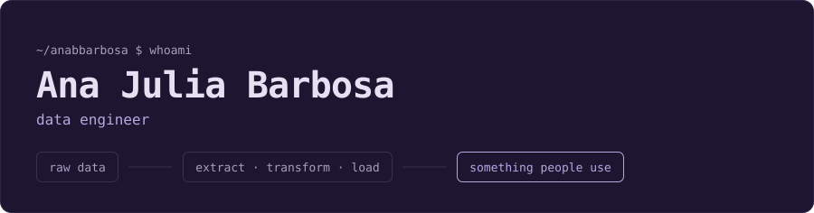
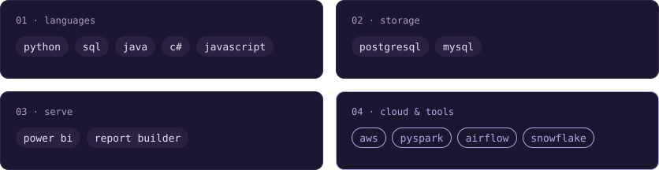
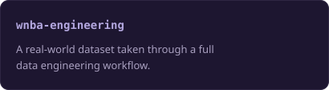

<a href="https://www.linkedin.com/in/anajbarbosa"><code>linkedin</code></a> /
<a href="https://instagram.com/anabbarbosaa"><code>instagram</code></a>

## Hi, I'm Ana

I'm a data engineer. I turn messy data into something people can actually use — pipelines, SQL, ETL and dashboards.

I studied Systems Analysis and Development, so I come at data from the software side. Lately I've been bringing AI into data workflows.

## Stack

## Projects

 

<code>currently → growing as a data engineer and learning modern data architecture.</code>
